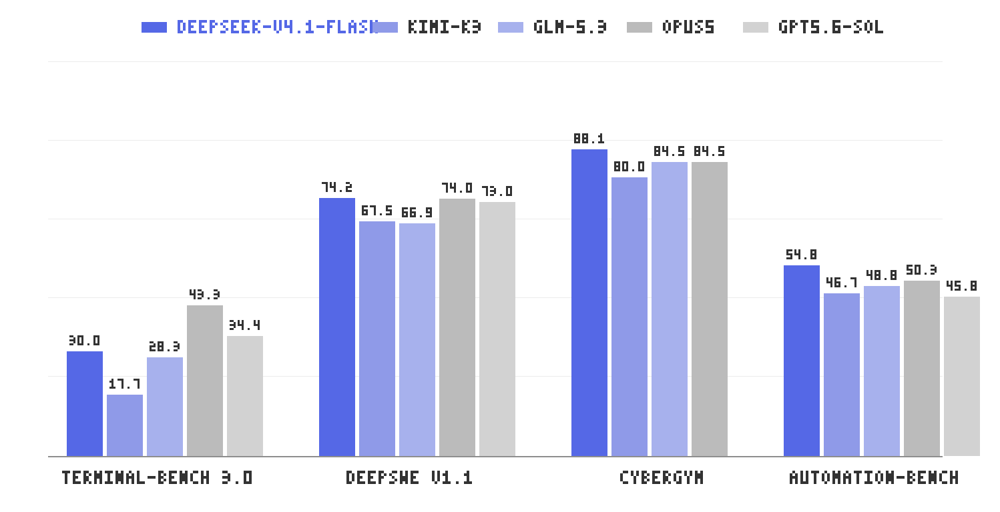

# Deepseek Family for Github Copilot Chat

Bring **DeepSeek V4.1 Flash** and **DeepSeek V4-Pro** into GitHub Copilot Chat — with visible chain-of-thought, tool calling, native image input on DeepSeek Flash, and a live account-balance status bar.

Install the Extension from [VSCode Marketplace](https://marketplace.visualstudio.com/items?itemName=Dootmaan.deepseek-family-for-github-copilot-chat) or search `DeepSeek Family for GitHub Copilot Chat` in VSCode Extension Store.

> **What's new in 1.0.3** — switched the built-in Flash entry to the new official `deepseek-flash` model, added native V4.1 Flash image-input support, restored the official `None / Low / High / Max` thinking-effort options, and kept retired Flash ids working through compatibility routing. See the [changelog](CHANGELOG.md).



This extension is modeled after [`glm-for-copilot`](https://github.com/KiwiGaze/glm-for-copilot) and adapted for the DeepSeek OpenAI-compatible API. Huge shout out to [@KiwiGaze](https://github.com/KiwiGaze) for his foundamental work and generous licensing.


## Highlights

- 🧠 **Selectable thinking effort** — every model exposes a **None / Low / High / Max** selector in the Copilot Chat model picker. DeepSeek's `reasoning_content` is forwarded to VS Code's thinking UI.
- 🚀 **Current official model lineup** — the picker exposes `deepseek-flash` as **DeepSeek V4.1 Flash** and keeps `deepseek-v4-pro` available as the current Pro endpoint.
- 🖼️ **Native image input on DeepSeek Flash** — image attachments are serialized into DeepSeek's official Chat Completions content-block format and sent to `deepseek-flash`.
- 🔁 **Compatibility for retired Flash ids** — if you pinned `deepseek-v4-flash` or `deepseek-v4-flash-vision-exp`, the extension maps them to `deepseek-flash` so old selections keep working.
- 💹 **Peak/off-peak pricing in the usage panel** — the usage detail view now lists per-1M-token input/output prices for each model. Chinese UI shows the official CNY table from the Chinese pricing page; English UI shows the official USD table from the English pricing page.
- 🛠️ **Full Copilot Chat integration** — tool calling, multi-turn reasoning preservation (passes `reasoning_content` back across tool-call turns to avoid the 400), and proper `tool_choice` handling.
- 🔐 **Bring-your-own-key** — your key lives in VS Code's SecretStorage (the OS keychain). Never written to `settings.json` or Git.
- 💰 **Live account balance** — a status-bar item polls `GET /user/balance` and surfaces your remaining credit; turns red when `is_available: false`.
- 🌐 **Single endpoint** — DeepSeek exposes one global base URL (`https://api.deepseek.com`); no region/apiMode gymnastics needed.

## Quick start

1. Install the extension.
2. Create a key at <https://platform.deepseek.com/api_keys>.
3. Run **DeepSeek: Set API Key** from the Command Palette and paste the key.
4. Open Copilot Chat, click the model picker, and pick **DeepSeek V4.1 Flash** or **DeepSeek V4-Pro**.
5. If you want to attach screenshots or other images, use **DeepSeek V4.1 Flash**.
6. (Optional) Use the per-model **Thinking Effort** selector to choose `None`, `Low`, `High`, or `Max`.

## Settings

| Setting | Default | Description |
| --- | --- | --- |
| `deepseek-copilot.baseUrl` | `""` | Override the DeepSeek API base URL (empty = official endpoint). |
| `deepseek-copilot.maxTokens` | `0` | Max output tokens per request (`0` = API default). |
| `deepseek-copilot.maxRetries` | `3` | Auto retries on HTTP 429 / 5xx (exponential backoff + `Retry-After`). |
| `deepseek-copilot.modelIdOverrides` | `{}` | Remap picker model ids to API model ids. |
| `deepseek-copilot.customModels` | `[]` | Add your own model entries to the picker. |
| `deepseek-copilot.debugLogging` | `false` | Verbose logs to the DeepSeek output channel. |
| `deepseek-copilot.showUsageStatusBar` | `true` | Show the balance status bar. |
| `deepseek-copilot.usageRefreshIntervalMinutes` | `5` | Refresh interval for the balance status bar (1–1440). |

## Commands

| Command | Description |
| --- | --- |
| `DeepSeek: Set API Key` | Save your DeepSeek key to SecretStorage. |
| `DeepSeek: Get API Key` | Open platform.deepseek.com/api_keys. |
| `DeepSeek: Clear API Key` | Remove the stored key. |
| `DeepSeek: Open Settings` | Jump to the extension's settings. |
| `DeepSeek: Show Logs` | Reveal the DeepSeek output channel. |
| `DeepSeek: Refresh Usage` | Force-refresh the balance status bar. |
| `DeepSeek: Show Usage Details` | Open the balance detail webview. |

## How thinking effort works

| Picker value | Wire body |
| --- | --- |
| **None** | `thinking: { type: "disabled" }, reasoning_effort: "none"` |
| **Low** | `thinking: { type: "enabled" }, reasoning_effort: "low"` |
| **High** | `thinking: { type: "enabled" }, reasoning_effort: "high"` |
| **Max** | `thinking: { type: "enabled" }, reasoning_effort: "max"` |

DeepSeek's default is **High**. Picking **Max** is recommended for hard coding and agentic tasks
(as Claude Code and OpenCode do automatically). Pick **None** to disable chain-of-thought entirely.
According to the current DeepSeek docs, legacy `minimal` normalizes to **Low**, and `medium` / `xhigh`
both normalize to **High**.

## Vision model notes

- **DeepSeek V4.1 Flash** is the current official image-capable model.
- Images are sent through `POST /chat/completions` using DeepSeek's official `content` block array with inline `image_url` data URLs.
- DeepSeek only accepts images in `user` messages, not `system`, `assistant`, or `tool` messages.
- Supported image formats are JPEG, PNG, GIF, and WebP.
- DeepSeek's retired ids `deepseek-v4-flash` and `deepseek-v4-flash-vision-exp` are temporarily routed by the backend to `deepseek-flash`.
- According to the latest pricing page, `deepseek-v4-pro` does **not** expose image understanding as a first-class capability; DeepSeek plans to route it to V4.1 Flash after 2026-09-14 12:00 Beijing time until V4.1 Pro is released.

## Pricing in the extension

- Open **DeepSeek: Show Usage Details** to see the current balance plus official per-model pricing.
- The panel lists **off-peak** and **peak** unit prices for input (cache hit), input (cache miss), and output, all per 1M tokens.
- In Chinese UI, prices are shown in **CNY** using the official Chinese pricing page.
- In English UI, prices are shown in **USD** using the official English pricing page.
- DeepSeek updates pricing frequently, so the panel includes a source note and routing note for retired ids.

See [docs/deepseek-api.md](docs/deepseek-api.md) for the full API reference.

## Development

```bash
pnpm install
pnpm run compile      # build to out/
pnpm run watch        # rebuild on save
pnpm run typecheck    # tsc --noEmit
pnpm run lint         # eslint
pnpm test             # vitest run
pnpm run package      # produce a .vsix in dist/
```

Press <kbd>F5</kbd> in VS Code to launch an Extension Development Host with the extension loaded.

## License

MIT
